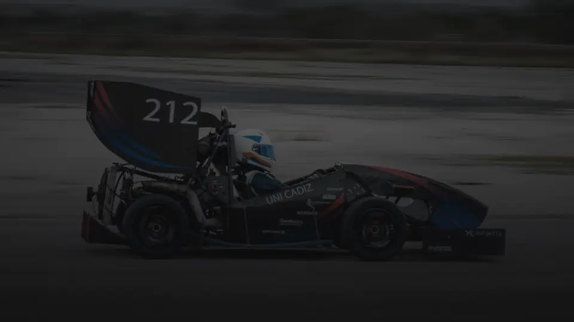
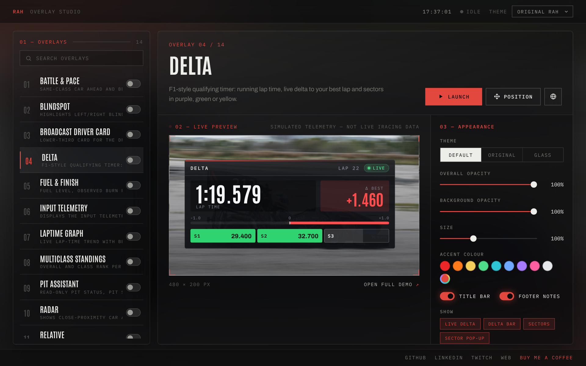
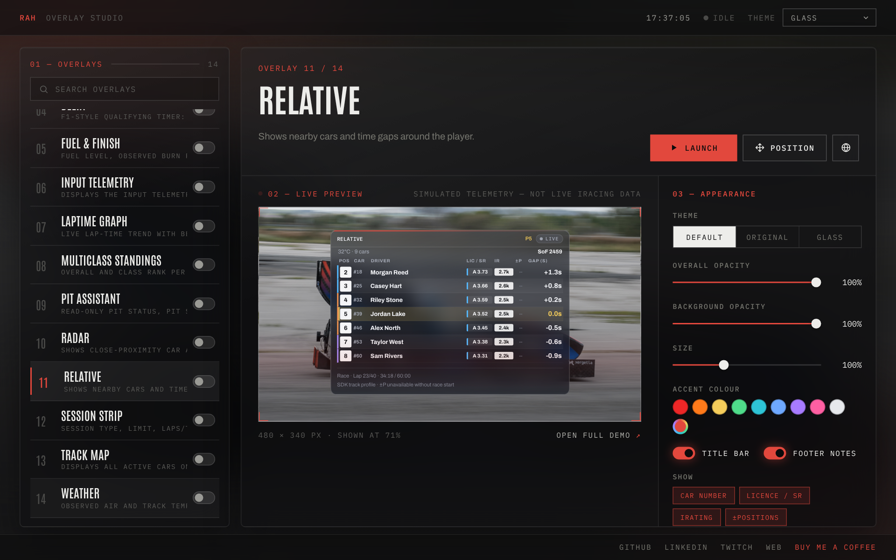
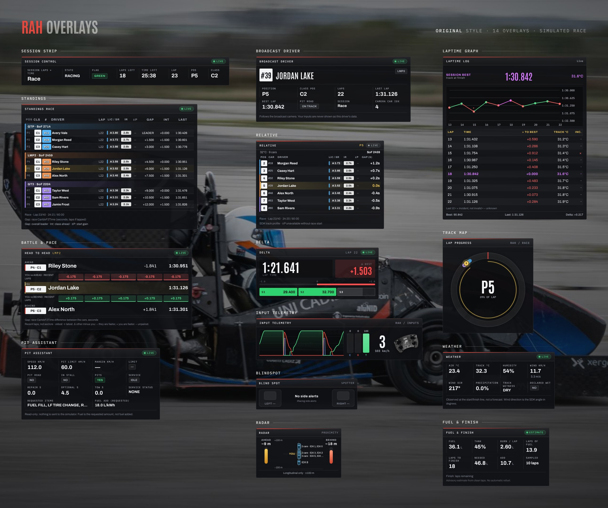
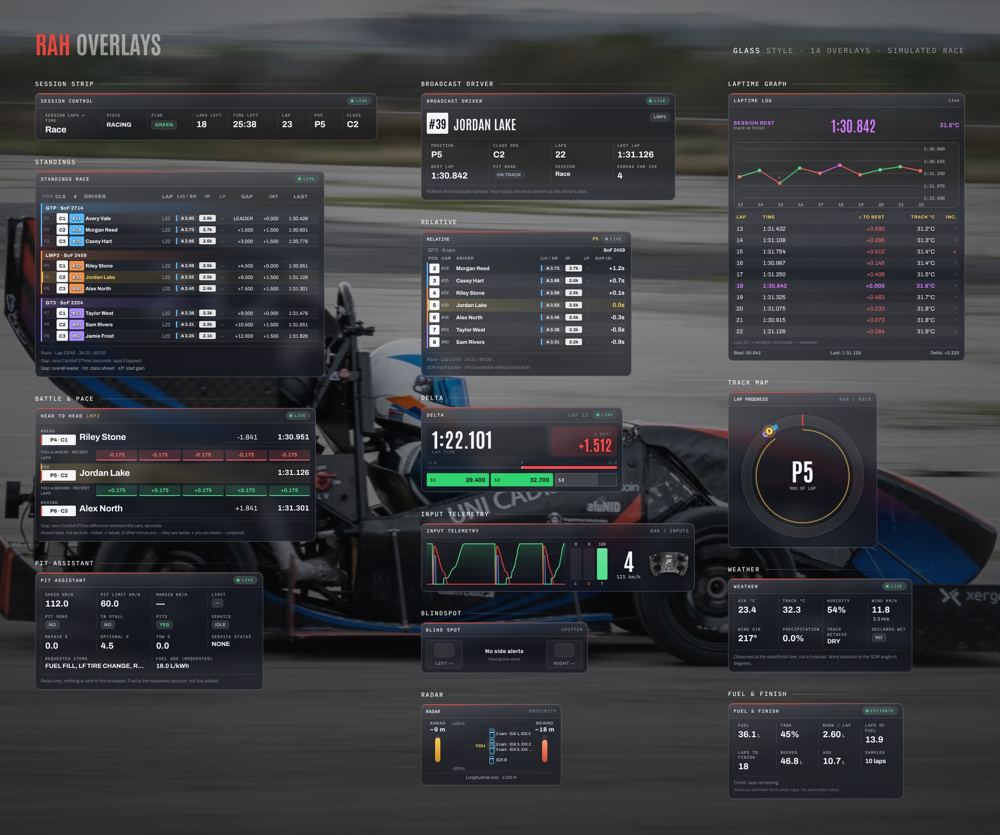

# **RAH iRacing Overlay**

**RAH iRacing Overlay** is a free, open-source suite of real-time iRacing overlays written in Python. Every overlay runs as a transparent window on top of the game, or as a web page you can add to OBS as a browser source.

I just didn't want to pay for overlay subscriptions to get the overlays I actually wanted, so why not try? I hope you feel the same. This is free, of course ;)

<p align="center">
  <a href="https://github.com/RaulArcos/rah-iracing-overlay/releases/download/v0.3.0/rah-overlays-promo.mp4"></a>
  <br>
  <sub><a href="https://github.com/RaulArcos/rah-iracing-overlay/releases/download/v0.3.0/rah-overlays-promo.mp4">Watch the full video (1080p)</a> · <a href="https://raularcos.github.io/overlays/">Try every overlay live in your browser</a></sub>
</p>

## **Table of Contents**

- [Download](#download)
- [Usage](#usage)
- [Available overlays](#available-overlays)
- [Compilation](#compilation)
- [Contributing](#contributing)
- [License](#license)

## **Download**

1. Download the latest `RAH_Telemetry_Overlay-*.zip` from the [Releases page](https://github.com/RaulArcos/rah-iracing-overlay/releases).
2. Extract the whole folder. Keep `RAH_Telemetry_Overlay.exe` next to its `_internal` folder; the executable does not work on its own.
3. Run `RAH_Telemetry_Overlay.exe`.

If Windows blocks the app after downloading, see [Windows Security](#windows-security-dll-blocking-after-download-mark-of-the-web).

## **Usage**

Open the `.exe` like any other Windows program. The launcher lets you open any overlay, move it, choose a theme and copy its web link for OBS.

<p align="center">
  
  
</p>

- **Themes:** choose **Original RAH** (solid dark/red) or **Glass** (translucent, rounded) in the launcher. Both show the same data and layout.
- **Appearance:** per-overlay opacity, background opacity, size, accent colour and title bar / footer toggles.
- **Previews and demo mode:** select an overlay to see a populated preview image. Click **Preview Demo** to watch it with animated fictional telemetry, without iRacing. The demo is clearly labelled as simulated and has **Pause / Resume**.
- **Real data:** overlays only show real values while iRacing is running. Without the simulator they stay in an empty state ("Waiting for data", "No data" or "--").

Every overlay is also available in a browser or OBS browser source:

| URL | Result |
|-----|--------|
| `http://127.0.0.1:8085/overlay/<name>` | Original RAH style (default) |
| `http://127.0.0.1:8085/overlay/<name>?theme=glass` | Glass style |
| `http://127.0.0.1:8085/overlay/<name>?demo=1` | Simulated demo data, never live |

`<name>` is the folder name from the [Available overlays](#available-overlays) table, for example `fuel_finish`. Theme details: [docs/overlay-themes.md](docs/overlay-themes.md). Preview and demo details: [docs/menu-previews.md](docs/menu-previews.md).

### Windows Security: DLL blocking after download (Mark-of-the-Web)

Some Windows downloads add a security mark (`Zone.Identifier`) to extracted binaries. This may block runtime DLL loading (`Python.Runtime.dll`, WebView DLLs).

Current releases include a startup safeguard that removes this mark from bundled runtime binaries before the telemetry stack initializes. If you still hit this issue, run this once inside the extracted release folder:

```powershell
Get-ChildItem -Recurse -File | Unblock-File
```

For maintainers: the robust long-term solution for public releases is code signing (Authenticode/Trusted Signing).

## **Available overlays**

All 14 overlays in both styles, running on a simulated race. Original is the default; Glass is translucent and works best over the game.

<p align="center">
  
</p>

<p align="center">
  
</p>

Every overlay is discovered automatically by the launcher and can be opened as `http://127.0.0.1:8085/overlay/<name>`.

| Overlay | Folder / route name | Purpose |
|---------|---------------------|---------|
| Input Telemetry | `input_telemetry` | Throttle, brake, clutch, steering and gear |
| Relative | `relative` | Nearby cars with SDK track-time gaps, license/iRating badges and class colours ([details](docs/relative-standings-design.md)) |
| Radar | `radar` | Nearby cars moving ahead/behind you, distance bars and left/right spotter warnings ([details](docs/radar-traffic-visual.md)) |
| BlindSpot | `blindspot` | Left/right blindspot warnings |
| Track Map | `track_map` | Cars on a lap-progress ring |
| Laptime Graph | `laptime_graph` | Lap-time graph and table with best lap, track temperature and incident laps ([details](docs/laplog-headtohead-design.md)) |
| Delta | `delta` | Running lap time, live delta to your best lap and sector colours |
| Fuel & Finish | `fuel_finish` | Fuel, observed burn per clean lap, advisory finish estimate ([details](docs/fuel-session.md)) |
| Session Strip | `session_strip` | Session type, laps/time remaining, state, flag and position ([details](docs/fuel-session.md)) |
| Battle & Pace | `battle_pace` | Same-class car ahead/behind, race gap and recent-lap comparison ([details](docs/battle-standings.md)) |
| Multiclass Standings | `standings` | Class groups with SoF, ratings, laps, last lap, pit flag and race gaps ([details](docs/battle-standings.md)) |
| Pit Assistant | `pit_assistant` | Read-only pit status, pit speed limit margin, repair/tow timers and requested service ([details](docs/pit-weather.md)) |
| Weather | `weather` | Observed air/track temperature, humidity, wind, precipitation and track wetness; not a forecast ([details](docs/pit-weather.md)) |
| Broadcast Driver Card | `broadcast_driver` | Lower-third card for the driver the broadcast camera follows ([details](docs/broadcast-driver.md)) |

Known data limits: in AI sessions iRacing does not provide your real license/iRating, so it is shown as unavailable; positions gained stay `--` because the SDK does not expose a confirmed starting grid; Radar shows longitudinal distance only, since iRacing does not provide each car's lateral position.

## **Compilation**

You can compile your own modified version, or use the precompiled one from the [Releases page](https://github.com/RaulArcos/rah-iracing-overlay/releases).

### **Prerequisites**

- **Windows** with **64-bit Python 3.10–3.13** ([download](https://www.python.org/downloads/windows/) or `winget install Python.Python.3.13`).
- Internet access the first time, to download the pinned dependencies.

### **Build**

```bash
git clone https://github.com/RaulArcos/rah-iracing-overlay.git
cd rah-iracing-overlay
build.bat
```

Or double-click `build.bat`. It:

1. creates an isolated `.venv-build` with the pinned versions from `requirements-build.txt` (your global Python is never touched, and the step is skipped when nothing changed);
2. runs the Python test suite;
3. builds `dist\RAH_Telemetry_Overlay\RAH_Telemetry_Overlay.exe` with PyInstaller;
4. zips it into `release\RAH_Telemetry_Overlay-<date>-<commit>.zip`, ready to share.

Options: `build.bat --skip-tests`, `build.bat --no-zip` (same flags for `python build_exe.py`). Close the overlay app before rebuilding.

### **Run from source**

```bash
pip install -r requirements.txt
python src/app.py
```

This opens the launcher and serves the overlays at `http://127.0.0.1:8085/`. There is no hot reload: restart after changing Python code, and refresh the overlay page after changing HTML, CSS or JS. A compiled `.exe` only contains what was built into it.

Tests: `python -m unittest discover -s tests` and `node --test tests/test_*.cjs`. Validation commands and the manual iRacing / OBS checklist are in [docs/race-suite-validation.md](docs/race-suite-validation.md).

### **Website demos**

`python scripts/build_web_demo.py <output-dir>` exports every overlay's demo as static files (`<output-dir>/demo/`) with relative URLs, ready for a static host. The overlays page at <https://raularcos.github.io/overlays/> is built from this: run it with the website repo's `overlays/` folder as the output, then commit there.

## **Contributing**

I hope you want to take part in this journey! Everyone is welcome to add new overlays showing interesting data: predicted points, tyre data... you name it! See [src/overlays/README.md](src/overlays/README.md) for the steps to add a new overlay.

1. Fork the project.
2. Clone your fork to your local machine.
3. Create a branch for your feature or fix:
```bash
git checkout -b feature-name
```
4. Commit your changes:
```bash
git commit -m "Add some feature"
```
5. Push your changes and open a pull request:
```bash
git push origin feature-name
```

## **License**

This project is licensed under the [MIT License](LICENSE).
